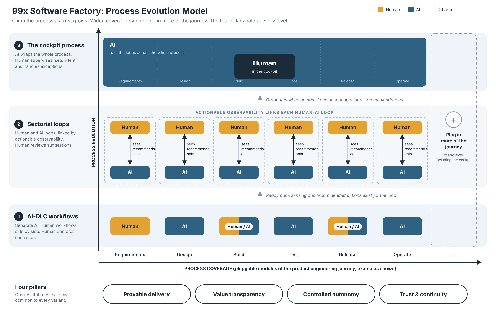
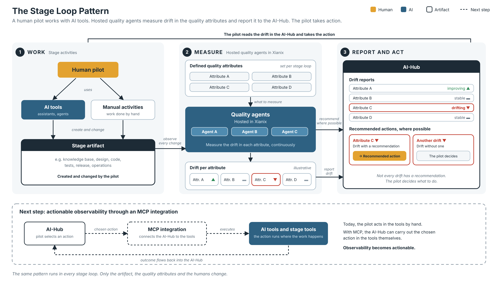

# 99x Software Factory: Process Evolution

This folder describes how 99x helps clients adopt AI for software product engineering in a way that evolves with their expectations, risk appetite, budget and the capability of the available tools. It covers what clients expect, a model for evolving the delivery process, and a specification for each stage of the delivery lifecycle.

**Status:** draft v0.1. Everything here comes from working sessions and is still being refined. Items marked **(proposed)** in the stage loop specs are suggestions that have not yet been confirmed.

## Contents

1. [Why: what clients expect](#1-why-what-clients-expect)
2. [The model](#2-the-model)
3. [The stage loop pattern](#3-the-stage-loop-pattern)
4. [The six stage loops](#4-the-six-stage-loops)
5. [Status and open questions](#5-status-and-open-questions)
6. [File index](#6-file-index)
7. [Editing the diagrams](#7-editing-the-diagrams)

## 1. Why: what clients expect

Clients want AI to optimize software delivery, but they expect more than speed. Five expectations came out of the first brainstorm, summarized as four pillars. These are the quality attributes of the process at the model level.

| Pillar | What the client is asking |
|---|---|
| **Provable delivery** | "Show me what AI is actually doing for my outcomes." |
| **Value transparency** *(working name)* | "If you get faster, I should see it in the price." |
| **Controlled autonomy** *(includes context grounding)* | "Agents do the work, but with my context, my standards and my approval points." |
| **Trust and continuity** | "I can rely on you, and I can leave without losing my software." |

The pillars are the same at every level of the model. What changes is how each one is delivered. The table is in [process-evolution-model.md](process-evolution-model.md#3-quality-attributes-the-four-pillars).

Background reading used in the first brainstorm (vendor and analyst material, so directional rather than definitive):
- [Software development outsourcing in the age of AI: buyer's guide 2026 (Enosis)](https://enosisoutsourcing.com/blog/outsourcing/software-development-outsourcing-in-the-age-of-ai)
- [Atlassian: the AI-native SDLC](https://www.atlassian.com/blog/company-news/team26-europe-ai-sdlc)
- [AlixPartners 2026 enterprise software technology predictions](https://www.alixpartners.com/newsroom/alixpartners-2026-enterprise-software-technology-predictions-report/)
- [DZone: software and DevOps trends shaping 2026](https://dzone.com/articles/software-devops-trends-shaping-2026)

## 2. The model

The model has two dimensions:

- **Process evolution (vertical):** how integrated and autonomous the process is. There are three variants, from bottom to top.
- **Process coverage (horizontal):** how much of the client's product engineering journey the process captures. It is pluggable, so it can be widened at every variant.

A client is a point on this grid. The whole project climbs together.

| Variant | What it is | Human role |
|---|---|---|
| **1. AI-DLC workflows** | Separate AI-Human workflows side by side, with little connection between them. This is the framework already built in [xianix-team/ai-dlc-base](https://github.com/xianix-team/ai-dlc-base). | Operates each step |
| **2. Stage loops** | A human layer above an AI layer, linked by actionable observability, one loop per stage of the lifecycle. Specified in this folder. | Acts on escalations and selects corrective actions |
| **3. The cockpit process** | AI systems do the work. The human at the centre monitors and corrects course continuously using AI tools. **Not yet designed.** | Supervisor in the cockpit |

**Why an evolution path:** technology is changing rapidly. A client who adopts today's process should be able to move up as tools improve without throwing away what they built, so the stage loops are meant to wrap the existing AI-DLC workflows, not replace them.

**Where a client sits** is set by their expectations, their ability to take risks, their budget and the capability of the available tools. The last one changes over time without any client action.

**Moving up** is decided by evidence. A loop moves up when humans accept its recommended actions at a high rate, sustained over time. Loops graduate individually, so a project can have some stages at the cockpit level while others are still stage loops. Because the stage loops are chained, a downstream loop depends on the quality of the artifacts the upstream loops produce.

**Actionable observability** is what separates variant 2 from variant 1. The platform shows what the AI is doing, then offers recommended actions the human can take through a portal to correct course. It is a sense, recommend, act loop, not a dashboard.

The full model is in [process-evolution-model.md](process-evolution-model.md). The original sketch is [process-evolution-model.png](process-evolution-model.png).

## 3. The stage loop pattern

*A human pilot works with AI tools and by hand. Hosted quality agents in Xianix measure drift in the defined quality attributes and report it to the AI-Hub, with recommended actions where possible. The dashed band shows the next step: actionable observability through an MCP integration. Source: [svg](stage-loop-pattern.svg).*

Every stage loop follows the same pattern:

> A governed artifact + quality attributes + a background validator + trend signals + recommended actions, with humans who act and decide.

1. Humans and AI add material to the governed artifact (a knowledge base, a codebase, a release and so on).
2. A background validator, a [Xianix](https://xianix.ai/) agent running on a stronger model, checks every change against the loop's quality attributes. It runs deterministic tools where tools can measure something, and uses the model for judgment.
3. The portal shows the trend of each attribute and recommends corrective actions.
4. Humans act on what is escalated.
5. Corrections go back into the artifact, and findings go back to earlier loops. This runs continuously.

Principles that apply to every loop:
- **Humans own every stage loop.** AI validates, warns and recommends. Humans decide.
- **Every declining quality attribute is escalated to the human,** not only those at an unacceptable level. Failing tests are escalated too: unit tests in build, tests in the test loop, pipeline checks in release. In operate, urgent incidents are paged immediately.
- **Trend over score.** The loops alert on direction and avoid false precision in absolute scores. "Unacceptable" levels carry a higher severity.
- **The validator is measured too.** The acceptance rate of its recommendations calibrates it, and is the same evidence used to graduate a loop.
- **Loops are chained along the coverage axis,** and each produces artifacts needed for product delivery.
- **Consequential decisions stay explicit and human:** readiness to move to the next stage (requirements and design), the trust endorsement (test), and go-live (release).

## 4. The six stage loops

| Stage | Governed artifact | Humans | Quality attributes | Spec | Diagram |
|---|---|---|---|---|---|
| **Requirements** | The requirements knowledge base, which improves over time and is read by every later stage | The team and client who build it. The human decides when it is ready for the next stage. | 12, confirmed | [spec](stage-loop-requirements.md) | [png](stage-loop-requirements.png) · [svg](stage-loop-requirements.svg) |
| **Design** | Five artifacts, one per sub-loop: business, software, data and infrastructure architecture, and UI/UX with an optional design system | An expert per sub-loop (architects and designers). A stage-level consistency check is owned by the engineering manager. | Shared core, design-wide and sub-loop attributes, all proposed | [spec](stage-loop-design.md) | [png](stage-loop-design.png) · [svg](stage-loop-design.svg) |
| **Build** | The codebase and unit tests | Engineers, working by exception: failing unit tests and declining attributes | 15, confirmed | [spec](stage-loop-build.md) | [png](stage-loop-build.png) · [svg](stage-loop-build.svg) |
| **Test** | Test cases, test code and results, derived from human-reviewed intents | Test engineers handle escalations. The trust architect endorses to the client that the application is fit for end users. | 15, proposed | [spec](stage-loop-test.md) | [png](stage-loop-test.png) · [svg](stage-loop-test.svg) |
| **Release** | The release package, deployment and rollback plans, release notes and evidence | The team lead, with a DevOps engineer if the project has one. The project team decides go-live after consulting the client. | 15, confirmed | [spec](stage-loop-release.md) | [png](stage-loop-release.png) · [svg](stage-loop-release.svg) |
| **Operate** | The operated product and its operational evidence (telemetry, incidents, tickets, runbooks, cost) | Operations engineers, support engineers and product owners | 15, proposed | [spec](stage-loop-operate.md) | [png](stage-loop-operate.png) · [svg](stage-loop-operate.svg) |

How the loops connect:

- **Requirements** produces the knowledge base that design, intent building, grooming, task creation and implementation all read.
- **Design** reads the requirements and produces the architectures the build, test and release loops check against.
- **Build** turns tasks and intents into code, with unit tests inside the loop.
- **Test** covers integration, system and acceptance testing, and ends in a trust endorsement.
- **Release** guards the last link: what ships is exactly what was endorsed, and it complies with the infrastructure architecture.
- **Operate** closes the factory. Findings return to the right earlier loop: defects to build, escapes to test, infrastructure gaps to design, and new intents to requirements. It also supplies the lagging data other loops rely on, such as escape rate and change failure rate.

## 5. Status and open questions

**Open across all loops**
- A shared core of quality attributes (clarity, traceability, currency, provenance, boundaries, validated assumptions) is proposed but not yet defined once for all loops.
- What counts as "unacceptable" for each attribute, and who sets it per client.
- What counts as a decline: a tolerance and time window per attribute, so small fluctuations do not flood the humans. This is proposed.
- What acceptance rate and time window make a loop ready to graduate.
- Plug-in order of the loops, and the minimum contract for a client who starts mid-chain and brings their own upstream artifacts.
- How the stage loops connect to the existing AI-DLC workflows in [ai-dlc-base](https://github.com/xianix-team/ai-dlc-base).
- The cockpit variant is to be designed later.
- The name of pillar 2 (value transparency) is a working name.

**Per loop,** each spec ends with its own open questions, such as who owns the Operate loop overall.

## 6. File index

| File | What it is |
|---|---|
| [README.md](README.md) | This file |
| [process-evolution-model.md](process-evolution-model.md) | The model: variants, pillars, ownership, escalation and graduation |
| [process-evolution-model-v2.png](process-evolution-model-v2.png) · [svg](process-evolution-model-v2.svg) | The model diagram |
| [process-evolution-model.png](process-evolution-model.png) | The original sketch |
| [stage-loop-pattern.png](stage-loop-pattern.png) · [svg](stage-loop-pattern.svg) | The generic stage loop pattern diagram |
| [stage-loop-requirements.md](stage-loop-requirements.md) | Requirements stage loop spec |
| [stage-loop-design.md](stage-loop-design.md) | Design stage loop spec |
| [stage-loop-build.md](stage-loop-build.md) | Build stage loop spec |
| [stage-loop-test.md](stage-loop-test.md) | Test stage loop spec |
| [stage-loop-release.md](stage-loop-release.md) | Release stage loop spec |
| [stage-loop-operate.md](stage-loop-operate.md) | Operate stage loop spec |
| `stage-loop-<stage>.png` and `.svg` | One diagram per stage loop, linked in the table above |
| [research/](research/) | Reserved for research material (empty for now) |

## 7. Editing the diagrams

Each diagram is provided as an SVG, which can be edited in any vector editor or text editor, and as a PNG export. The status values and example recommendations shown in the stage loop diagrams are illustrative.
