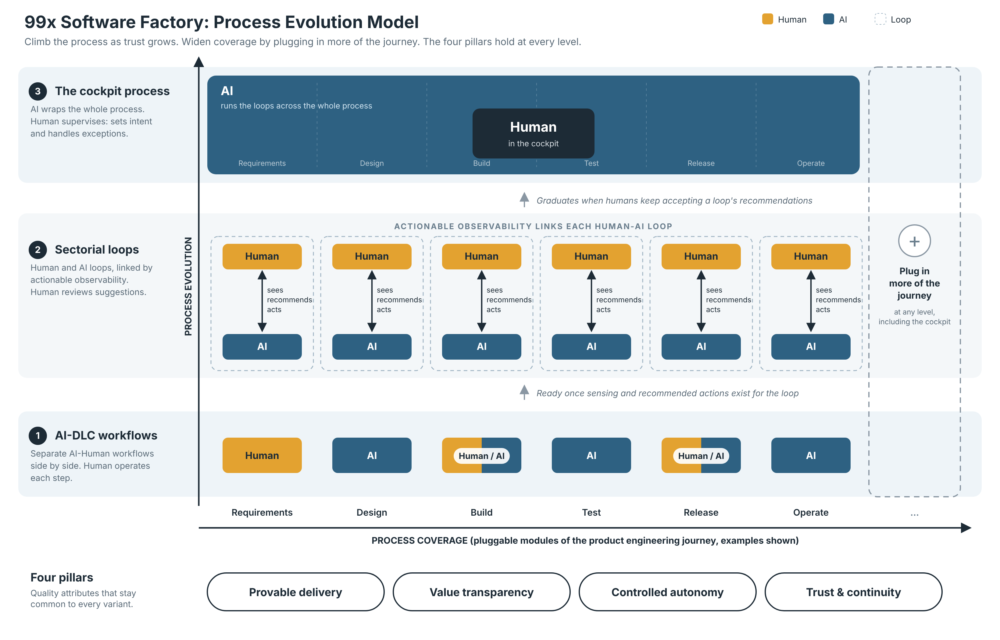

# Process Evolution Model (draft v0.1)

How 99x Software Factory evolves a client's product engineering process according to their expectations, risk appetite, budget and the capability of available tools.

*Original sketch: [process-evolution-model.png](process-evolution-model.png). Editable source of the diagram: [process-evolution-model-v2.svg](process-evolution-model-v2.svg).*

## 1. The model in brief

Two dimensions:

- **Process Evolution (vertical):** how integrated and autonomous the process is. Three variants, from bottom to top.
- **Process Coverage (horizontal):** how much of the client's product engineering journey the process captures. Pluggable, so it can be widened at every variant, including the cockpit.

The whole project climbs together. A client is a point on this grid, not a rung on a ladder.

## 2. Process variants

| Variant | What it is | Human role |
|---|---|---|
| **1. AI-DLC series AI-Human workflows** | Separate workflows, each done by a human, by AI, or by either. Little connection between them. | Operator of each step |
| **2. Multi-layer process with stage loops** | A human layer above an AI layer, linked by actionable observability. Each loop covers one stage of the lifecycle. | Reviewer of recommended actions |
| **3. The cockpit process** | AI systems do the work across the process. The human at the centre monitors and corrects course continuously, using AI tools to observe, get recommendations, steer and correct. | Supervisor in the cockpit |

### Actionable observability
The platform shows information about what the AI layer is doing, then offers recommended actions the human can take through the portal to correct course. It is a sense, recommend, act loop, not a dashboard. This link is what makes variant 2 different from variant 1.

### Stage loop specs
- [Requirements stage loop](stage-loop-requirements.md)
- [Design stage loop](stage-loop-design.md)
- [Build stage loop](stage-loop-build.md)
- [Test stage loop](stage-loop-test.md)
- [Release stage loop](stage-loop-release.md)

## 3. Quality attributes (the four pillars)

The four pillars stay common to every variant. They are the quality attributes of the process. What changes between variants is how each one is delivered.

| Pillar | Variant 1 | Variant 2 | Variant 3 |
|---|---|---|---|
| **Provable delivery** | Per-workflow output metrics | Loop-level outcomes via observability | End-to-end outcome telemetry |
| **Value transparency** *(working name; was "shared-gain commercials")* | Effort saved, estimated | Measured per loop | Priced on outcomes |
| **Controlled autonomy** *(includes context grounding)* | Human approves every step | Human approves recommended actions | Human sets intent and exceptions |
| **Trust and continuity** | Standard access controls | Auditable action trail | Full audit, replay, exit path |

## 4. What decides a client's position

**Target variant** is set by four inputs:
1. The client's expectations
2. Their ability to take risks
3. Available budget
4. The capability of the available tools (this one changes over time without client action)

**Ownership.** Every stage loop is owned by humans, at every variant and at every level of AI autonomy. AI validates, warns and recommends. Humans decide.

**Escalation.** In every stage loop, any quality attribute that is going down is escalated to the human, not only those that reach an unacceptable level. In the build loop, failing unit tests are escalated too. The human selects the corrective action.

**Graduation** is decided by evidence. A loop moves up when humans accept its recommended actions at a high rate, sustained over time. Loops graduate individually, so a project can have some stages at the cockpit level while others are still at variant 2. Stage loops are chained along the coverage axis, so a downstream loop depends on the quality of the artifacts upstream loops produce.

## 5. Open questions

- What acceptance rate and time window count as "ready to graduate" a loop? (placeholder: to be set from pilot data)
- Is the cockpit the destination for every client? Current stance: yes, for clients who want the fully autonomous factory with human oversight. Others may stay where they are.
- Does the grid need a named set of coverage modules (requirements, build, test, release, operate...)? And in what order should they plug in?
- How often does 99x reassess the achievable variant per client as tools improve?
- Pillar 2 wording: "value transparency" is a working name.
