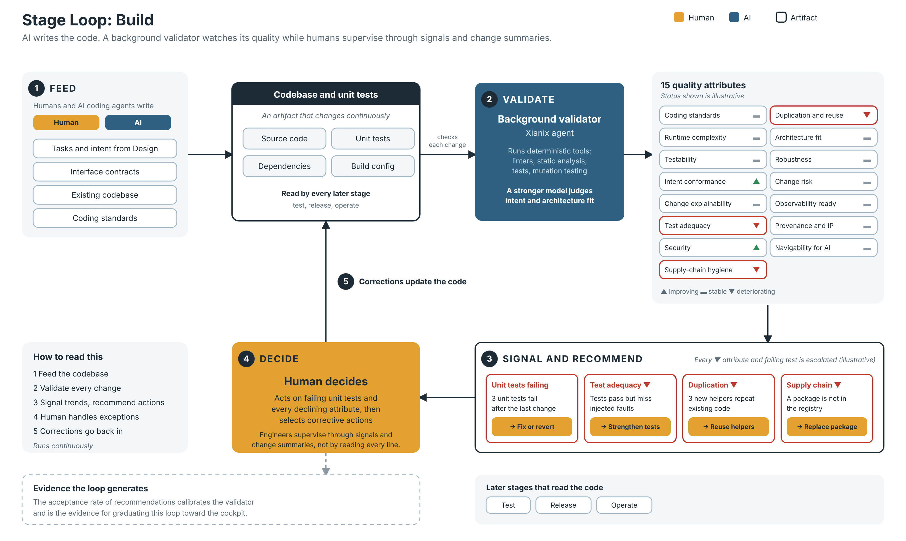

# Stage Loop: Build (draft v0.1)

*Editable source: [stage-loop-build.svg](stage-loop-build.svg). Status values and examples in the diagram are illustrative.*

The third stage loop of the 99x Software Factory process evolution model (see [process-evolution-model.md](process-evolution-model.md)). It follows the same pattern as the [requirements](stage-loop-requirements.md) and [design](stage-loop-design.md) stage loops. This is the loop where the code is created.

Items marked **(proposed)** were suggested during the brainstorm and are not yet confirmed.

## 1. The pattern

> A governed artifact + quality attributes + a background validator + trend signals + recommended actions, with a human who decides.

| Element | Build stage loop |
|---|---|
| **Governed artifact** | The codebase, including unit tests |
| **Feeders (human and AI)** | Tasks and intent from the design stage, interface contracts, the existing codebase and coding standards. Humans and AI coding agents write the code. |
| **Quality attributes** | Section 2 |
| **Background validator** | A Xianix agent that runs deterministic tools (linters, static analysis, test runners, mutation testing) and uses a stronger model to judge the attributes that tools cannot measure |
| **Signal** | Per-attribute trend plus warnings for unacceptable attributes |
| **Recommended actions** | When an attribute deteriorates, the tool shows it and recommends actions to correct course |
| **Human** | Owns the loop. Handles exceptions (failing unit tests and declining quality attributes), then selects corrective actions. Humans are not expected to read code at the level they did in the past, so they supervise through the signals and change summaries. |

Unit testing lives inside the build loop. (Integration, system and acceptance testing belong to the test stage loop, still to be specced.)

## 2. Quality attributes of AI-generated code

The loop checks that the intents are delivered and that the outcome is sound. It does not dictate how the AI writes the code. For this reason, code simplicity was considered and removed: it conflicted with other important attributes (such as runtime complexity), and as long as the intents are delivered there is no need to interfere with how the code is generated.

Check: **M** = mechanical, **H** = hybrid, **J** = needs human judgment.

### Defined in the original brief

| # | Attribute | What it means | Check |
|---|---|---|---|
| 1 | **Coding standards adherence** | The code follows the agreed coding standards. Kept as a cheap mechanical check for consistency and tooling. | M |
| 2 | **Runtime complexity** | Functions choose the less complex path at runtime (for example O(n) instead of O(n²)), including the choice of data structures and algorithms behind it | H |
| 3 | **Testability** | The code is easy to test | H |

Notes:
- #2 is about runtime behaviour. It can be checked by static analysis of loops and nesting, and by running functions on growing input sizes. It should be judged against the expected data scale and the performance budget from the design.
- "Data structures and algorithms" was a separate attribute and has been folded into #2, since the structure and algorithm chosen determine the runtime complexity and the outcome is what matters.

### Added in the brainstorm and agreed

| # | Attribute | What it means | Check |
|---|---|---|---|
| 4 | **Intent conformance** | The code does what the task and design say, with no unrequested features and none missing | H |
| 5 | **Change explainability** | Each change comes with a summary in intent terms of what changed and why, so a human can assess it without reading code | H |
| 6 | **Test adequacy** | Tests pass and cover the change, and a mutation score shows they detect faults | M |
| 7 | **Security** | No vulnerabilities, secrets or unsafe patterns | M |
| 8 | **Dependency and supply-chain hygiene** | No hallucinated or nonexistent packages, licences checked, no vulnerable or abandoned dependencies, versions pinned | M |
| 9 | **Duplication and reuse** | New code reuses what exists instead of duplicating it | M |
| 10 | **Architectural conformance** | The code respects the layers, boundaries and interface contracts from the design loop | M/H |
| 11 | **Robustness** | Errors are handled and not swallowed, inputs are validated, failure modes from the design are covered | H |
| 12 | **Change risk** | Size of the diff, files touched and churn, so large AI changes are visible | M |
| 13 | **Observability readiness** | Logs, metrics and traces exist as the design requires | M/H |
| 14 | **Provenance and IP** | Which agent, model and spec version produced the code, and that licence and IP checks passed | M |
| 15 | **Navigability for AI** | Naming, modularity and intent comments that let future agents work on the code safely | H |

Testability (#3) is a property of the code. Test adequacy (#6) is whether the tests are worth anything. Both are needed, because AI-written tests can pass while proving nothing.

## 3. Signal design

Same as the other stage loops: the portal shows per-attribute trends, escalates every declining attribute to the human, with higher severity for unacceptable levels, and recommends corrective actions. Humans decide, and ownership stays with humans. Humans work by exception. Exceptions are failing unit tests and declining quality attributes. Humans handle them and select corrective actions, instead of approving each change. The validator's quality is tracked by the acceptance rate of its recommendations.

Most of this loop can be measured by tools, which contrasts with the design loop. The validator should orchestrate deterministic tools and reserve the stronger model for the judgment attributes (intent conformance, architecture fit). A model should not be asked to judge what a tool can measure.

Intent conformance and change explainability replace what code review used to give humans, so they should be prominent in the portal.

## 4. Consumers

The codebase is read by the later stages: test, release and operate. Each change should record the task, design and knowledge-base versions it was built from (see the traceability proposals in the [requirements spec](stage-loop-requirements.md)).

## 5. Open questions

- **(proposed)** What counts as a decline should be defined by a tolerance and a time window per attribute, so that small fluctuations across 15 attributes do not flood the human. Escalations should be grouped and ranked by severity.
- The by-exception model applies to every stage loop (see the process evolution model). Working by exception is close to the cockpit variant, so how do the stage loops differ from the cockpit once all of them escalate by exception?
- What is "unacceptable" for each attribute, and who sets it per client?
- Tooling differs per technology stack. How does the validator get the right tools per language and framework, given the diverse stacks 99x teams work with?
- How does this connect to the existing AI-DLC workflows in xianix-team/ai-dlc-base?
- Where exactly is the boundary with the test stage loop (unit tests in build, everything else in test)?
