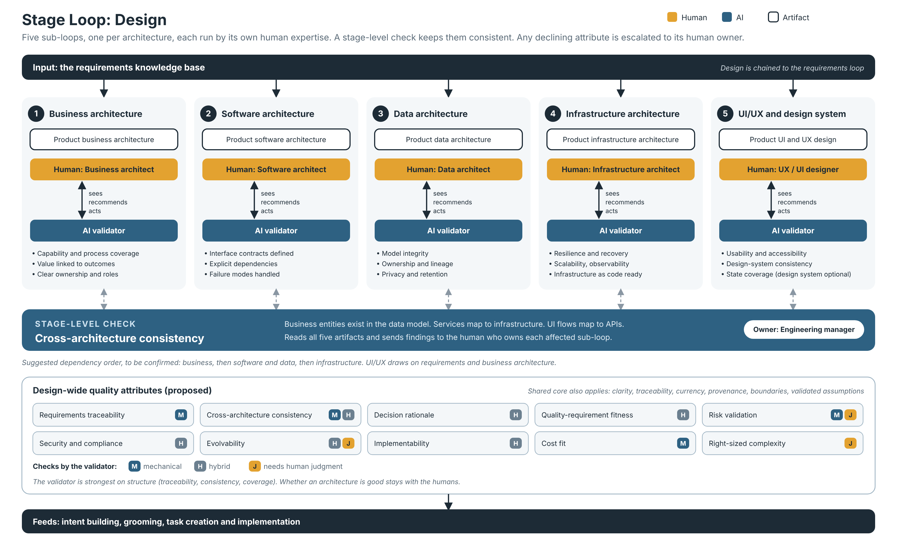

# Stage Loop: Design (draft v0.1)

*Editable source: [stage-loop-design.svg](stage-loop-design.svg). Status values and examples in the diagram are illustrative.*

The second stage loop of the 99x Software Factory process evolution model (see [process-evolution-model.md](process-evolution-model.md)). It follows the same pattern as the [requirements stage loop](stage-loop-requirements.md): a governed artifact, quality attributes, a background validator, trend signals, recommended actions, and a human who decides.

Items marked **(proposed)** were suggested during the brainstorm and are not yet confirmed.

## 1. Structure: five sub-loops

The client, the team and AI build the fundamental components of the product. The design stage is made of five sub-loops, because different human expertise works in each one.

| Sub-loop | Governed artifact | Human expertise (proposed) |
|---|---|---|
| **Business architecture** | Product business architecture | Business analyst / business architect |
| **Software architecture** | Product software architecture | Software architect |
| **Data architecture** | Product data architecture | Data architect |
| **Infrastructure architecture** | Product infrastructure architecture | Infrastructure / platform architect |
| **UI/UX and design system** | Product UI and UX design, including a design system if required | UX / UI designer |

Each sub-loop runs the same pattern as the requirements loop. It has its own artifact, its own validator view, and its own humans who act on recommendations. Sub-loops can be plugged in individually. The design system is optional.

Design is chained to the requirements loop. It reads the requirements knowledge base, and its artifacts feed intent building, grooming, task creation and implementation.

## 2. Quality attributes

### Shared core (same as the requirements loop) (proposed)
Clarity, traceability, currency, provenance and confidence, boundaries (no open ends), validated assumptions.

### Design-wide attributes (proposed)
Check: **M** = mechanical, **H** = hybrid, **J** = needs human judgment.

| Attribute | What it means | Check |
|---|---|---|
| **Requirements traceability** | Every design element traces to a requirement or intent, and every requirement is addressed by the design (both directions) | M |
| **Cross-architecture consistency** | The five architectures agree (for example business entities exist in the data model, services map to infrastructure, UI flows map to APIs) | M/H |
| **Decision rationale** | Key decisions are recorded with options considered, trade-offs, who decided, and whether they are reversible | H |
| **Quality-requirement fitness** | Each non-functional need has a stated design answer with evidence | H |
| **Risk validation** | High-risk decisions are backed by a spike, prototype or other evidence | M/J |
| **Security and compliance by design** | Threats, data classification and regulatory needs are addressed | H |
| **Evolvability** | Modular boundaries, low coupling and replaceable parts | H/J |
| **Implementability** | Defined enough for intent building, grooming and task creation to proceed, with interface contracts in place | H |
| **Cost fit** | Build and run costs are visible and within budget | M |
| **Right-sized complexity** | No more complex than the problem and the team need | J |

### Sub-loop-specific attributes (proposed)

| Sub-loop | Additional attributes |
|---|---|
| **Business architecture** | Capability and process coverage, value linked to outcomes, clear ownership and roles |
| **Software architecture** | Interface contracts defined, dependencies explicit, failure modes handled |
| **Data architecture** | Model integrity (entities, keys, relationships), data ownership and lineage, privacy classification and retention |
| **Infrastructure architecture** | Resilience and recovery, scalability, observability built in, environment parity, infrastructure as code readiness |
| **UI/UX and design system** | Usability against user journeys, accessibility, design-system consistency, coverage of states (empty, error, loading), responsiveness |

## 3. Signal design

Same as the requirements loop: the portal shows per-attribute trends, escalates every declining attribute to the human who owns it, with higher severity for unacceptable levels, and recommends corrective actions. The human decides what to do and when the design is ready for the next stage. The validator is a Xianix agent on a stronger model, and its quality is tracked by the acceptance rate of its recommendations.

The validator can reliably check structure (traceability, consistency, coverage of quality requirements, recorded decisions). It cannot reliably judge whether an architecture is good. The interface should show which signals are mechanical and which are advisory.

## 4. Cross-sub-loop consistency (proposed)

With five separate sub-loops, the biggest risk is that the architectures drift apart, since no single sub-loop sees the others. The cross-architecture consistency check therefore cannot live inside any one sub-loop. It has to run at the level of the whole design stage, reading all five artifacts, and surface its findings to the human who owns each affected sub-loop. The check is owned by the engineering manager of the project, who routes findings to the architects and designers who own the affected sub-loops.

Design sub-loops also depend on each other. A plausible order is business, then software and data, then infrastructure, with UI/UX drawing on requirements and business architecture. This order needs confirming.

## 5. Open questions

- What is the dependency order between the five sub-loops, and can they run in parallel?
- What is "unacceptable" for each attribute, and who sets it per client?
- If a client plugs in only one sub-loop (for example UI/UX), what must they bring from the others?
- Which human roles are expected in each sub-loop, and how do they split work with AI?
- Which attributes in the shared core should be defined once for all stage loops?
