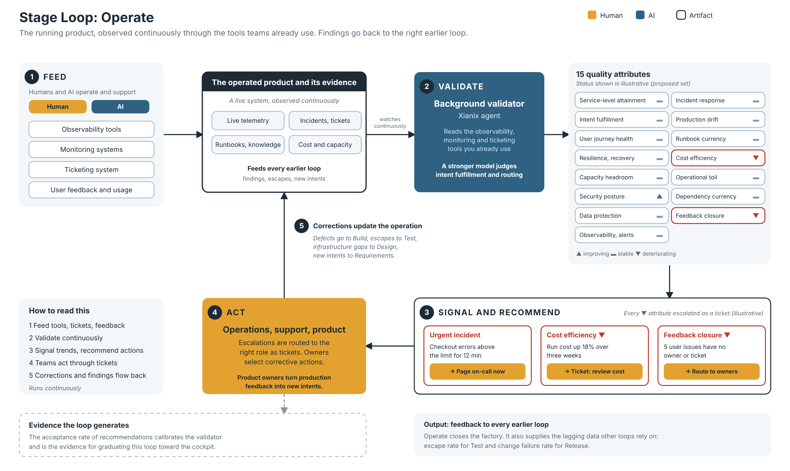

# Stage Loop: Operate (draft v0.1)

*Editable source: [stage-loop-operate.svg](stage-loop-operate.svg). Status values and examples in the diagram are illustrative.*

The sixth and last stage loop of the 99x Software Factory process evolution model (see [process-evolution-model.md](process-evolution-model.md)). It follows the same pattern as the [requirements](stage-loop-requirements.md), [design](stage-loop-design.md), [build](stage-loop-build.md), [test](stage-loop-test.md) and [release](stage-loop-release.md) stage loops.

The purpose of this loop is to make sure the product keeps delivering the intents in production, reliably, securely and sustainably, and that what is learned flows back to the right earlier loop. It closes the factory.

Items marked **(proposed)** were suggested during the brainstorm and are not yet confirmed.

## 1. The pattern

> A governed artifact + quality attributes + a background validator + trend signals + recommended actions, with humans who act and decide.

| Element | Operate stage loop |
|---|---|
| **Governed artifact** | The operated product and its operational evidence: live telemetry, incidents and tickets, runbooks and knowledge, cost and capacity data. Unlike the earlier loops, the artifact is a running system. |
| **Feeders (human and AI)** | Observability tools, monitoring systems, the ticketing system, and user feedback and usage. This stage is driven mainly by these tools. |
| **Quality attributes** | Section 2 (proposed set) |
| **Background validator** | A Xianix agent that reads the observability, monitoring and ticketing tools the teams already use, continuously, and uses a stronger model to judge the attributes tools cannot measure, such as intent fulfillment and feedback routing |
| **Signal** | Per-attribute trend. Every declining attribute is escalated, as a ticket. |
| **Recommended actions** | When an attribute declines, the tool shows it and recommends corrective actions, such as raising or routing a ticket |
| **Humans** | A large group: **operations engineers**, **support engineers** and **product owners** |

The loop should work through the tools the teams already use and not replace them. The portal brings their signals together, and actions are taken through them, for example by creating or routing tickets.

## 2. Quality attributes (proposed)

Check: **M** = mechanical, **H** = hybrid, **J** = needs human judgment.

### Is it delivering what was promised? (service)

| Attribute | What it means | Check |
|---|---|---|
| **Service-level attainment** | Availability, latency and error rate meet the agreed service-level objectives | M |
| **Intent fulfillment in production** | The intents are actually delivered to users, measured by usage and outcome signals tied to each intent | H |
| **User journey health** | Critical journeys succeed in real use and under synthetic checks | M/H |

### Is it resilient and secure? (protection)

| Attribute | What it means | Check |
|---|---|---|
| **Resilience and recovery** | Failure recovery, redundancy and failover work and are tested | M/H |
| **Capacity headroom** | Load and growth have room, with no surprises under peak | M |
| **Security posture** | Vulnerabilities, patch currency, access and threat detection | M |
| **Data protection and compliance** | Privacy, retention and regulatory needs are met, and backups are verified | M/H |

### Can we see and respond? (response)

| Attribute | What it means | Check |
|---|---|---|
| **Observability and alert quality** | Logs, metrics and traces cover the system, and alerts are actionable with low noise | M/H |
| **Incident response** | Time to detect and restore, runbooks that exist and are tested, and postmortems completed | M/H |
| **Production drift** | The running system still matches the infrastructure architecture and the released version | M |
| **Runbook and knowledge currency** | Runbooks, documentation and architecture records match reality | H |

### Is it sustainable, and does it learn? (sustainability)

| Attribute | What it means | Check |
|---|---|---|
| **Cost efficiency** | Run cost is within budget and explained | M |
| **Operational toil** | Manual interventions and recurring incidents are tracked and reduced | H |
| **Dependency and platform currency** | Upgrades, end-of-life components and third-party risk | M |
| **Feedback closure** | Production findings are routed to the right earlier loop and resolved | M/H |

Notes:
- Feedback closure is what makes this loop part of the factory. A code defect goes to the build loop, an escape goes to the test loop, an infrastructure gap goes to the design loop, and a missing intent or new need goes to the requirements loop.
- Operate supplies the lagging data that other loops rely on: escape rate for the test loop and change failure rate and time to restore for the release loop.

## 3. Who acts on what (proposed)

With a large group of humans, routing matters. Each escalation should go to the role that can act on it.

| Role | Escalations they would handle |
|---|---|
| **Operations engineers** | Service-level attainment, resilience, capacity, security, data protection, observability and alert quality, incident response, production drift, cost, toil and dependency currency |
| **Support engineers** | User journey health, user-reported incidents, runbook and knowledge currency, and the support side of feedback closure |
| **Product owners** | Intent fulfillment in production, prioritisation of feedback, and turning production findings into new intents for the earlier loops |

## 4. Signal design

The same as the other stage loops: every declining attribute is escalated to the human, with higher severity for unacceptable levels. Ownership stays with humans.

**(proposed)**
- Production telemetry changes constantly, so alert fatigue is the biggest practical risk. What counts as a decline should be defined by a tolerance and a time window per attribute, and escalations should be grouped and ranked by severity.
- Urgent incidents, such as an outage, cannot wait in a queue. They should be paged immediately, separately from the trend escalations.

## 5. Open questions

- Who owns the Operate loop overall, given the large group? For example an operations lead or the product owner.
- Does the loop include evolving the product after launch (new intents from production feedback), or only keeping the system healthy? The product owners' role suggests it does, and this spec assumes so.
- Who operates the product: the project team, or the client's own operations and support teams? This may differ per client.
- Observability, monitoring and ticketing tools differ per client. How does the validator integrate with whatever they use?
- Where is the boundary between intent fulfillment in production and product analytics?
- What is "unacceptable" for each attribute, and who sets it per client?
- How does this connect to the existing AI-DLC workflows in xianix-team/ai-dlc-base?
