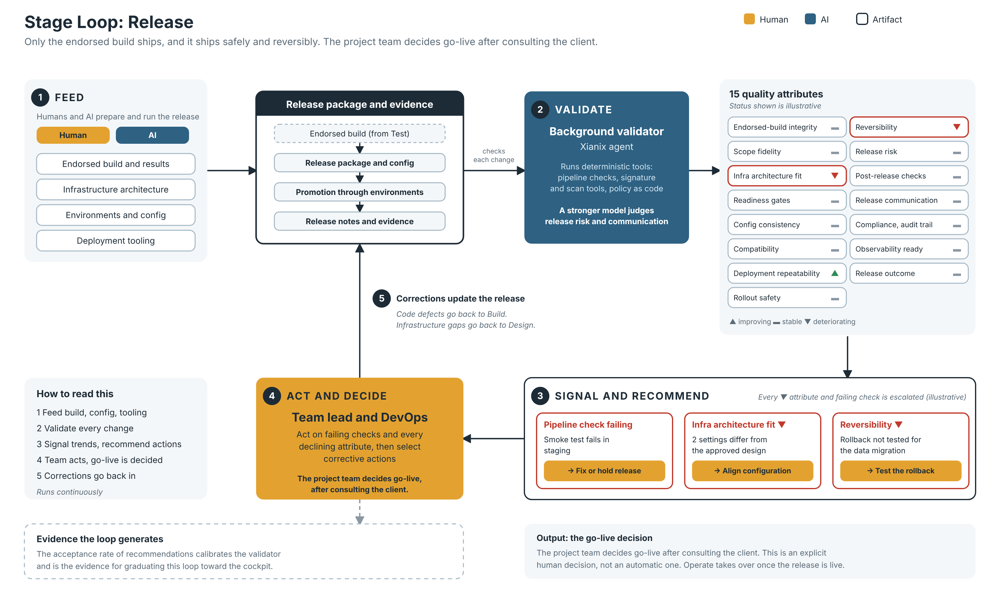

# Stage Loop: Release (draft v0.1)

*Editable source: [stage-loop-release.svg](stage-loop-release.svg). Status values and examples in the diagram are illustrative.*

The fifth stage loop of the 99x Software Factory process evolution model (see [process-evolution-model.md](process-evolution-model.md)). It follows the same pattern as the [requirements](stage-loop-requirements.md), [design](stage-loop-design.md), [build](stage-loop-build.md) and [test](stage-loop-test.md) stage loops.

The purpose of this loop is to make sure that what is shipped is exactly what was endorsed, and that it ships safely and can be undone. This is also the place where the release artifacts must be shown to meet the compliance requirements of the infrastructure architecture produced in the design stage.

Items marked **(proposed)** were suggested during the brainstorm and are not yet confirmed.

## 1. The pattern

> A governed artifact + quality attributes + a background validator + trend signals + recommended actions, with humans who act and decide.

| Element | Release stage loop |
|---|---|
| **Governed artifact** | The release: the release package (builds, configuration, migrations), the deployment and rollback plans, the release notes, and the evidence of promotion through environments |
| **Chain** | The endorsed build from the test loop becomes the release package, which is promoted through environments with its release notes and evidence |
| **Feeders (human and AI)** | The endorsed build and its results, the infrastructure architecture, environments and configuration, and deployment tooling |
| **Quality attributes** | Section 2 |
| **Background validator** | A Xianix agent that runs deterministic tools (pipeline checks, signature and scan tools, policy as code) and uses a stronger model to judge the attributes tools cannot measure, such as release risk and communication |
| **Signal** | Per-attribute trend. Every declining attribute and every failing pipeline check is escalated to the human. |
| **Recommended actions** | When an attribute declines or a check fails, the tool shows it and recommends corrective actions |
| **Humans** | The **team lead** handles the day-to-day work and escalations, together with a **DevOps engineer** if the project has one. The **project team decides go-live**, after consulting the client. |

## 2. Quality attributes

Check: **M** = mechanical, **H** = hybrid, **J** = needs human judgment.

### Is it exactly what was endorsed? (integrity and readiness)

| Attribute | What it means | Check |
|---|---|---|
| **Endorsed-build integrity** | The deployed artifact is the exact build the trust architect endorsed. It is signed and tamper-evident, with a software bill of materials. | M |
| **Scope fidelity** | The release contains the endorsed intents, nothing unendorsed and nothing missing | M/H |
| **Infrastructure architecture fit** | The release artifacts (deployment configuration, infrastructure as code, target environments) comply with the product's infrastructure architecture from the design stage, including resilience, scalability, observability, security and environment parity | M/H |
| **Readiness gates** | Prerequisites are met: tests pass, scans are clean, approvals recorded, and accepted defects documented | M |
| **Configuration and environment consistency** | Configuration is code, secrets are handled safely, and there is no drift between environments | M |
| **Compatibility** | APIs, dependent systems and data remain compatible with the version going out | M/H |

### Can it ship safely? (safety)

| Attribute | What it means | Check |
|---|---|---|
| **Deployment repeatability** | Deployment is automated, reproducible and idempotent | M |
| **Rollout safety** | Canary, blue-green or flag-based rollout limits the blast radius, with health checks | M/H |
| **Reversibility** | Rollback or roll-forward is tested, including for data migrations | M/H |
| **Release risk** | Change size, timing and risk score are visible | M/H |
| **Post-release verification** | Smoke tests and health checks run after deployment against stated success criteria | M |

### Can it be understood and governed? (governance)

| Attribute | What it means | Check |
|---|---|---|
| **Release communication** | Release notes describe the changes in intent terms, and support, operations and the client are ready | H |
| **Compliance and audit trail** | Approvals, change records and regulatory evidence are kept | M |
| **Observability readiness** | Dashboards, alerts and service-level objectives are set for the new version | M/H |
| **Release outcome** | Change failure rate and time to restore, from operate. This is the lagging attribute, like escape rate in the test loop. | M |

Notes:
- Endorsed-build integrity and scope fidelity guard the last link in the trust chain: if what ships differs from what was tested, the test assurance means nothing.
- Infrastructure architecture fit is the attribute that checks release artifacts against the infrastructure architecture sub-loop of the design stage.
- Post-release verification belongs here. Ongoing health belongs to the operate loop, and release outcome depends on operate data.

## 3. Signal design

The same as the other stage loops. Every declining attribute is escalated to the human, with higher severity for unacceptable levels, and a failing pipeline check is escalated too. Ownership stays with humans.

- **(proposed)** What counts as a decline is defined by a tolerance and a time window per attribute, so small fluctuations do not flood the human. Escalations are grouped and ranked by severity.
- Code defects found in the release go back to the build loop. Infrastructure gaps go back to the design loop.

## 4. The go-live decision

Go-live is an explicit human decision. The project team decides, after consulting the client. It is not automatic, and it does not follow the by-exception model that applies to escalations. The loop provides the evidence for the decision: the status of every quality attribute, the trust endorsement from the test loop, and the open risks.

**(proposed)**
- The decision record names who decided and which client contacts were consulted, as part of the compliance and audit trail.

## 5. Consumers

The operate loop takes over once the release is live. Release outcome data (change failure rate, time to restore) flows back from operate into this loop.

## 6. Open questions

- If the project has no DevOps engineer, does the team lead carry the whole loop?
- If a release rolls out progressively (for example canary then full), does each stage need its own go decision, or only the first?
- What is "unacceptable" for each attribute, and who sets it per client?
- How does release outcome data return from operate into this loop?
- How does this connect to the existing AI-DLC workflows in xianix-team/ai-dlc-base?
