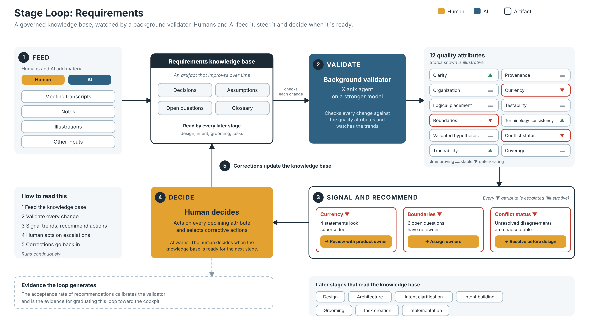

# Stage Loop: Requirements (draft v0.1)

*Editable source: [stage-loop-requirements.svg](stage-loop-requirements.svg). Status values and examples in the diagram are illustrative.*

The first stage loop of the 99x Software Factory process evolution model (see [process-evolution-model.md](process-evolution-model.md)). It sets the pattern the other stage loops follow.

Items marked **(proposed)** were suggested during the brainstorm and are not yet confirmed.

## 1. The pattern

> A governed artifact + quality attributes + a background validator + trend signals + recommended actions, with a human who decides.

| Element | Requirements stage loop |
|---|---|
| **Governed artifact** | The knowledge base. It improves over time. |
| **Feeders (human and AI)** | Meeting transcripts, notes, illustrations and other inputs added by the team and by AI |
| **Quality attributes** | Section 3 |
| **Background validator** | A Xianix agent running on a stronger model. It checks every growth step of the knowledge base against the quality attributes. |
| **Signal** | Per-attribute trend (improving, stable, declining). Every declining attribute is escalated to the human. |
| **Recommended actions** | When an attribute deteriorates, the tool shows it and recommends actions to correct course |
| **Human** | Acts on every escalation by selecting a corrective action, and decides when the knowledge base is ready for the next stage. AI warns but does not decide. |

## 2. How the loop runs

1. Humans and AI add material to the knowledge base.
2. The validator checks the change against the quality attributes.
3. The portal shows attribute trends. If any attribute is deteriorating, it says so and recommends corrective actions.
4. The human acts on every escalation by selecting a corrective action.
5. Repeat continuously.

Whether recommendations are accepted is recorded. The acceptance rate is the evidence for graduating this loop toward the cockpit (see the process evolution model) and for calibrating the validator.

## 3. Quality attributes of the knowledge base

Confirmed (1 to 5 from the original brief, 6 to 12 added in the brainstorm and agreed):
1. **Clarity.** Information is presented without ambiguity.
2. **Organization.** Information is well structured.
3. **Logical placement.** Information sits where it belongs, with no logical contradictions.
4. **Boundaries.** Information has proper boundaries, with no open ends.
5. **Validated hypotheses.** Assumptions are questioned and validated.
6. **Traceability.** Every statement points to its source (transcript, note, stakeholder).
7. **Provenance and confidence.** Whether it was stated, inferred or confirmed, and by whom.
8. **Currency.** Stale or superseded information and overturned decisions are flagged.
9. **Testability.** Each requirement can be verified, with an acceptance criterion existing or writable.
10. **Terminology consistency.** One term per concept, backed by a glossary.
11. **Conflict status.** Stakeholder disagreements are tracked as open or resolved.
12. **Coverage.** Stakeholders, processes and edge cases covered, against what is known to be in scope.

Note: 1 and 2 overlap, and 4 is close to 12. Revisit if the validator cannot tell them apart.

## 4. Signal design

- **Trend over score.** The loop alerts on direction (for example "organization is deteriorating") and avoids false precision in absolute scores. This is deliberate: some attributes are mechanically checkable (contradictions, open ends) while others are judgment calls (clarity).
- **Escalation on any decline.** Every attribute that is going down is escalated to the human. This applies to all stage loops. Unacceptable levels carry a higher severity.
- **The human decides.** Warnings do not block the work or declare the stage complete. Readiness for the next stage is a human decision. Ownership of this loop, as for every stage loop, stays with humans.
- **(proposed)** What counts as "unacceptable" (severity) should be defined per attribute, and probably per client.
- **(proposed)** What counts as a decline should be defined by a tolerance and a time window per attribute, so that small fluctuations do not flood the human. Escalations should be grouped and ranked by severity.

## 5. The validator

- A Xianix agent running on a stronger model than the one doing most of the work.
- Its quality is measured by the acceptance rate of its recommendations. A validator whose advice humans keep rejecting is miscalibrated.
- **(proposed)** A stronger model is not an independent one. Consider periodic human spot checks of the validator itself.

## 6. Chained stage loops and consumers of the knowledge base

Stage loops are chained. They move along the coverage axis of the process evolution model, and each one produces artifacts required for product delivery. The requirements loop is the first link: its artifact, the knowledge base, feeds the loops that follow.

The knowledge base is a shared artifact that improves over time. It is used in design, architecture, intent clarification, intent building, grooming, task creation and other implementation-related work. The quality of this knowledge base bounds the quality of every loop that reads it.

**(proposed)**
- Downstream work records which version of the knowledge base it used.
- When a requirement changes after work has been derived from it (for example tasks already created), the tool alerts the affected downstream work.

## 7. Open questions

- What is "unacceptable" for each attribute, and who sets it per client?
- What are the artifacts of the other stage loops (design, build, test, release, operate)? Does the same pattern hold for code and tests?
- Each loop in the chain needs a defined input and output artifact. A client who plugs in only a later stage (for example Build) must be able to bring their own upstream artifacts. What is the minimum contract for importing them?
- Which attributes can be checked mechanically and which need judgment? This decides what the validator can do reliably.
- How are humans notified, and how often does the validator run (on every change, periodically, or both)?
- How does this connect to the existing AI-DLC workflows in xianix-team/ai-dlc-base?
