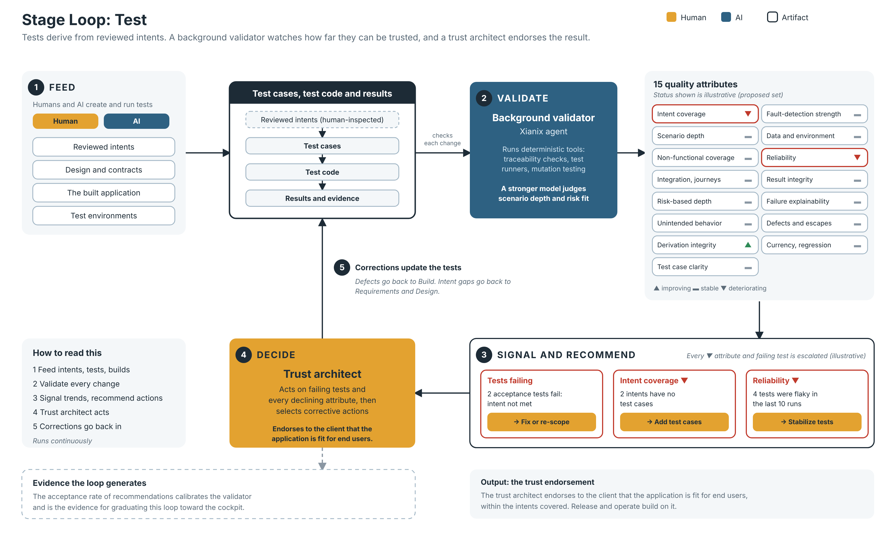

# Stage Loop: Test (draft v0.1)

*Editable source: [stage-loop-test.svg](stage-loop-test.svg). Status values and examples in the diagram are illustrative.*

The fourth stage loop of the 99x Software Factory process evolution model (see [process-evolution-model.md](process-evolution-model.md)). It follows the same pattern as the [requirements](stage-loop-requirements.md), [design](stage-loop-design.md) and [build](stage-loop-build.md) stage loops.

The purpose of this loop is to increase trust in the assurance that what is built is what is expected from the set of intents it covers. Unit tests belong to the build loop. This loop covers integration, system and acceptance testing.

Items marked **(proposed)** were suggested during the brainstorm and are not yet confirmed.

## 1. The pattern

> A governed artifact + quality attributes + a background validator + trend signals + recommended actions, with a human who decides.

| Element | Test stage loop |
|---|---|
| **Governed artifact** | The test cases, the test code and the results and evidence |
| **Derivation chain** | Test code is based on the test cases. Test cases are developed from the specifications (intents), which are inspected by a human reviewer. The test cases are reviewed by humans too, and the quality attributes tell the reviewers which parameters to work on. |
| **Feeders (human and AI)** | Reviewed intents, design and contracts, the built application and the test environments. Humans and AI create and run the tests. |
| **Quality attributes** | Section 2 (proposed set) |
| **Background validator** | A Xianix agent that runs deterministic tools (traceability checks, test runners, mutation testing) and uses a stronger model to judge the attributes tools cannot measure, such as scenario depth and risk fit |
| **Signal** | Per-attribute trend. Every declining attribute and every failing test is escalated to the human. |
| **Recommended actions** | When an attribute declines or a test fails, the tool shows it and recommends corrective actions |
| **Humans** | **Test engineers** handle the day-to-day escalations and select corrective actions. The **trust architect** endorses to the client that the application is fit to be used by end users. |

## 2. Quality attributes (proposed)

These are chosen to increase trust in the assurance. They are grouped by three questions. Check: **M** = mechanical, **H** = hybrid, **J** = needs human judgment.

### Are the right things tested? (coverage)

| Attribute | What it means | Check |
|---|---|---|
| **Intent coverage** | Every intent in scope has tests, and every test traces to an intent. Gaps and orphan tests are listed. | M |
| **Scenario depth** | Per intent: normal, negative, boundary, edge and error paths | H |
| **Non-functional coverage** | Performance, security, accessibility and resilience are tested against the design's quality requirements | H |
| **Integration and journey coverage** | Interfaces and contracts between components and the critical user journeys are exercised | M/H |
| **Risk-based depth** | Test depth is proportionate to the risk and criticality of each intent | H/J |
| **Unintended behavior detection** | Surfaces behavior that exists in the product but that no intent asked for | H |

### Can the tests be believed? (validity)

| Attribute | What it means | Check |
|---|---|---|
| **Derivation integrity** | Test code derives from test cases, test cases derive from the human-reviewed version of the intents, and nothing derives from the implementation | M/H |
| **Test case clarity** | Test cases have unambiguous steps and expected results | H |
| **Fault-detection strength** | Seeded faults and mutations are caught at integration and system level | M |
| **Data and environment fidelity** | Test data is realistic and privacy-safe, and environments match production closely | M/H |
| **Reliability** | Results are deterministic and the flakiness rate is low | M |

### Can the results be trusted and used? (evidence)

| Attribute | What it means | Check |
|---|---|---|
| **Result integrity and provenance** | Results are recorded tamper-evidently, with the build, intent version and environment they ran against | M |
| **Failure explainability** | A failure is reported as "this intent is not met, because…", so a human can act without reading logs | H |
| **Defect handling and escape rate** | Defects are traced to intents, triaged and root-caused, with a regression test added. Defects that escape to release or operate are counted. | M/H |
| **Currency and regression protection** | Tests are updated when intents change, and fixed defects and changed areas stay covered | M |

Notes:
- The derivation chain makes independence from the implementation structural. It replaces the earlier idea of an "independence" attribute: the loop checks that the chain is intact instead.
- Escape rate is the only lagging attribute. It needs data from release and operate, and it shows whether the other attributes are working. It is also how the validator can be calibrated over time.
- Build's test adequacy attribute is the unit-level version of fault-detection strength.

## 3. Signal design

The same as the other stage loops. Every declining attribute is escalated to the human, with higher severity for unacceptable levels. In this loop, a failing test is an escalation too: it means an intent is not met, or a defect exists. Ownership stays with humans.

- The quality attributes also guide the humans: they show test engineers and reviewers which parameters to work on, for example scenario depth for a specific intent or clarity of a particular test case.
- **(proposed)** What counts as a decline is defined by a tolerance and a time window per attribute, so small fluctuations do not flood the human. Escalations are grouped and ranked by severity.
- Defects found by the loop go back to the build loop. Gaps in the intents go back to the requirements and design loops.

## 4. The trust architect and the endorsement

Test engineers handle the day-to-day work and escalations. The trust architect is the human who endorses to the client that the application is fit to be used by end users. This is a human decision, based on the evidence the loop produces.

**(proposed)**
- The trust architect's endorsement should be explicitly scoped to the intents covered, so the loop never implies assurance beyond them. If the intents are incomplete or wrong, full coverage can still describe the wrong product, so trust is bounded by the quality of the requirements knowledge base.
- The endorsement can be supported by an assurance case: the claim that the product meets the intents in scope, the arguments, and the evidence from the quality attributes. A residual-risk record lists what is not covered and which known defects were accepted.

## 5. Consumers

The release and operate stages build on the endorsement and the results. Escape-rate data flows back from them into this loop.

## 6. Open questions

- Where does the human inspection of intents happen: in the requirements and design loops, or in a separate intent-building step?
- What is "unacceptable" for each attribute, and who sets it per client?
- How does escape-rate data return from release and operate into this loop?
- How does this connect to the existing AI-DLC workflows in xianix-team/ai-dlc-base?
